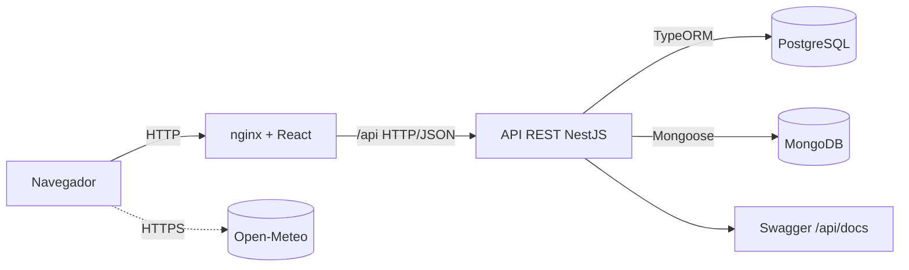

# ReservaUNAB: plataforma de reserva de espacios (Full Stack)

Plataforma web para consultar, solicitar y administrar los espacios de la **Sede Viña del Mar** de la Universidad
Andrés Bello: salas de clases, laboratorios, salas de estudio, salas de reunión y espacios exteriores.

**Hito 3 de Desarrollo Web y Móvil (2º semestre 2026)**, caso *3.1 Gestión de espacios universitarios*. Es la
evolución del prototipo React del Taller Evaluado 2 hacia una solución con backend propio, PostgreSQL y MongoDB.

| Versión | Entrega | Qué es |
|---|---|---|
| [`version-1-html/`](version-1-html/) | Taller 1 | HTML, CSS, Bootstrap y JavaScript |
| tag `v1.0.0` | Taller 2 | React con datos en JSON y `localStorage` |
| `v2.0.0` (este README) | Hito 3 | React + API REST NestJS + PostgreSQL + MongoDB + Docker |

## Integrantes
- Camilo Quintana
- Axel Antezana

## Problema y usuarios
En la sede no hay un lugar único para saber qué espacios están libres ni para reservarlos: la información está
dispersa, se producen choques de horario y los laboratorios se piden en persona. Tampoco hay datos sobre qué
espacios se usan.

- **Estudiantes** (y docentes u organizaciones estudiantiles): necesitan un espacio por una hora para estudiar,
  trabajar en grupo, hacer una práctica de laboratorio o una actividad al aire libre.
- **Administración de la sede** (actor nuevo en el Hito 3): mantiene el catálogo de edificios y espacios, revisa
  las solicitudes de laboratorios y espacios exteriores, y necesita indicadores de uso.

## Continuidad con el Taller 2

| Se conserva | Se modifica | Se agrega |
|---|---|---|
| El caso, los 24 espacios, los bloques de 1 hora, los colores y los componentes | Los datos pasan de JSON/`localStorage` a la API | Backend NestJS con API REST y Swagger |
| Las reglas "bloque ocupado", "una reserva por día" y "horario pasado" | Las reglas se aplican en el backend (y en la base) | PostgreSQL (modelo relacional) y MongoDB (bitácora) |
| La validación del RUT | El perfil simulado se reemplaza por registro e inicio de sesión con contraseña | Roles: estudiante y administración |
| Open-Meteo con aviso de lluvia | Se reserva hasta 7 días adelante (antes: hoy o mañana) | Solicitudes con aprobación y rechazo |
| Filtros en la URL, responsive y accesibilidad | El edificio y el equipamiento son entidades | Historial, bitácora de actividad e indicadores |
| | | Docker Compose, pruebas unitarias y end-to-end |

El diagnóstico completo, las historias de usuario y los modelos están en **[docs/diseno.md](docs/diseno.md)**.

## Funcionalidades del Hito 3
Todas las funcionalidades obligatorias del caso 3.1:

| Requisito del caso | Cómo se cumple |
|---|---|
| Administración de edificios, salas y laboratorios | `Administración → Espacios` y `Edificios y equipamiento`: crear, editar, activar/desactivar y eliminar, con validaciones (piso existente, nombre único por edificio, no borrar con historial) |
| Capacidad, equipamiento, ubicación y disponibilidad | Cada espacio tiene edificio, piso, capacidad y equipamiento con cantidad; el catálogo muestra los bloques libres del día elegido y el detalle, el estado de cada bloque |
| Solicitudes, aprobación, rechazo y cancelación | Laboratorios y exteriores quedan *pendientes*; la administración aprueba o rechaza con motivo; el estudiante o la administración cancelan |
| Validación de conflictos de horario | Servicio + índice único parcial en PostgreSQL (resiste peticiones simultáneas); una reserva activa por día; capacidad; anticipación de 7 días |
| Reservas personales e historial | `Mis reservas`: pestañas Próximas e Historial, y la línea de tiempo de cada reserva (MongoDB) |
| Panel e indicadores de utilización | `Administración → Indicadores`: solicitudes por revisar, ocupación en días hábiles (general, por tipo, edificio y espacio), demanda por horario, estado de las reservas con tasas de cancelación y rechazo, movimiento diario (con el día en curso marcado) y detalle por día. Bandas de ocupación baja/media/alta, período en la URL (`/admin?periodo=7`), ranking completo de los 24 espacios con enlace a cada ficha y exportación a CSV |

**Cómo se calcula la ocupación:** horas reservadas (reservas aprobadas) de lunes a viernes ÷ horas disponibles de lunes a
viernes (espacios activos × 13 bloques × días hábiles). Los días cuentan desde la primera reserva registrada, para no
tratar como "vacíos" los días en que el sistema todavía no existía; el panel avisa "Hay datos desde…" cuando el período
elegido empieza antes. Toda la sección "Utilización de espacios" (demanda por horario, ocupación por tipo y edificio, y
el ranking con su columna Reservas) usa esa misma base de lunes a viernes, así el orden del ranking coincide con sus
números. La sección "Gestión de reservas" sí incluye los fines de semana: cuenta todas las reservas con fecha en el
período, según su estado actual.

**Bandas de ocupación (supuesto del equipo):** como la sede no tiene una meta oficial, el panel usa tres bandas para
poder leer si un valor es bajo o alto: **Baja** (menos de 10%), **Media** (10% a 25%) y **Alta** (25% o más). Se muestran
como etiqueta junto al KPI de ocupación y en cada fila del ranking (siempre con el texto, no solo el color), y los
gráficos por tipo y por edificio tienen una línea dorada en el 10%. Los límites están en un solo lugar
(`frontend/src/components/indicadores/bandas.js`), así que se pueden ajustar si la sede define una meta.
En pantalla no se muestra de qué base viene cada gráfico: el estado y los totales salen de PostgreSQL, y el movimiento
diario de la colección `eventos` de MongoDB.

## Arquitectura



- **React** muestra la interfaz y consume la API con `services/api.js` (agrega el token y normaliza los errores) y
  el hook `useApi` (estados cargando / error / listo, cancelación y reintento).
- **NestJS** concentra las reglas de negocio. Cada módulo separa controlador (HTTP), DTO (validación), servicio
  (reglas y persistencia) y entidad o esquema (datos). Las reglas de reserva son funciones puras con pruebas propias.
- **PostgreSQL** guarda el estado actual: usuarios, edificios, espacios, equipamiento y reservas.
- **MongoDB** guarda la bitácora de eventos: qué pasó, cuándo y quién lo hizo.
- **nginx** (en Docker) sirve el frontend compilado y redirige `/api` al backend, así no hace falta CORS.

## Tecnologías

| Parte | Tecnologías |
|---|---|
| Frontend | React 19.2, Vite 8, React Router 7, Bootstrap 5.3 (solo CSS), Bootstrap Icons, oxlint |
| Backend | Node.js 22, NestJS 11, TypeScript 5.9, TypeORM 0.3, Mongoose 8, class-validator, JWT (`@nestjs/jwt`), bcryptjs, `@nestjs/swagger` |
| Bases de datos | PostgreSQL 16, MongoDB 7 |
| Pruebas | Jest 29, Supertest |
| Ejecución | Docker Compose, nginx 1.27 |

Usamos NestJS 11 y no la 12 (publicada a fines de agosto de 2026) porque la 12 cambió a módulos ESM y tiene menos
documentación y ejemplos; la 11 sigue recibiendo actualizaciones.

## Modelo de datos

### SQL (PostgreSQL)
`usuarios`, `edificios`, `espacios`, `equipamiento`, `espacio_equipamiento` (N:M con cantidad) y `reservas`.
Diagrama entidad-relación y restricciones en [docs/diseno.md](docs/diseno.md#3-modelo-de-datos-sql-postgresql).

Lo más importante:
- Claves foráneas con `RESTRICT` (no se borra un edificio con espacios ni un espacio con reservas).
- Restricciones `CHECK` (capacidad > 0, asistentes > 0, formato del bloque, pisos 1 a 30).
- **Índices únicos parciales** sobre las reservas activas: impiden la doble reserva y la segunda reserva del día a
  nivel de base de datos, incluso con dos peticiones simultáneas.
- El esquema se crea con una **migración** de TypeORM y los datos de prueba con un **script reproducible**.

### NoSQL (MongoDB): colección `eventos`
Un documento por cada acción (`reserva.creada`, `reserva.aprobada`, `espacio.actualizado`, `usuario.sesion_iniciada`,
etc.) con el actor, la entidad afectada y datos propios de cada tipo. Se usa en el **historial de cada reserva**, la
**bitácora de actividad** y el **movimiento diario** del panel (agregación por día).

**Por qué MongoDB:** los eventos tienen una forma distinta según el tipo, guardan una fotografía de los datos en ese
momento (aunque después se renombre o borre el espacio), solo se insertan y crecen rápido. **No duplica a SQL:**
PostgreSQL dice en qué estado está una reserva; MongoDB dice cómo llegó a ese estado. Detalle y ejemplo de documento
en [docs/diseno.md](docs/diseno.md#4-modelo-documental-mongodb).

## API REST y Swagger
- Base: `http://localhost:3000/api`
- **Swagger UI: http://localhost:3000/api/docs** (contrato JSON en `/api/docs-json`)
- Para probar rutas protegidas en Swagger: ejecutar `POST /api/auth/login` con una cuenta de prueba, copiar el
  `token` y pegarlo en **Authorize**.

| Recurso | Endpoints |
|---|---|
| Autenticación | `POST /auth/registro`, `POST /auth/login`, `GET/PATCH /auth/yo` |
| Edificios | `GET /edificios`, `GET /edificios/:id`, `POST`, `PATCH /:id`, `DELETE /:id` |
| Equipamiento | `GET /equipamiento`, `POST`, `PATCH /:id`, `DELETE /:id` |
| Espacios | `GET /espacios` (filtros y bloques libres), `GET /espacios/:id`, `GET /espacios/:id/disponibilidad`, `POST`, `PATCH /:id`, `DELETE /:id` |
| Reservas | `POST /reservas`, `GET /reservas/mias`, `GET /reservas` (admin), `GET /reservas/:id`, `GET /reservas/:id/historial`, `PATCH /reservas/:id/aprobar`, `/rechazar`, `/cancelar` |
| Indicadores | `GET /indicadores?desde&hasta` (admin) |
| Actividad | `GET /actividad` (admin, MongoDB) |
| Sistema | `GET /salud`, `GET /configuracion` |

Tabla completa con entradas, salidas y códigos HTTP en [docs/diseno.md](docs/diseno.md#6-diseño-de-endpoints).
Todos los errores responden con el mismo formato (`statusCode`, `error`, `mensaje` y, si falla la validación,
`detalles` por campo) y nunca incluyen el stack, el SQL ni datos de conexión.

## API pública: Open-Meteo

| | |
|---|---|
| API | Open-Meteo Weather Forecast API — documentación: https://open-meteo.com/en/docs |
| Endpoint y método | `GET https://api.open-meteo.com/v1/forecast` |
| Parámetros | `latitude=-33.02`, `longitude=-71.55`, `hourly=temperature_2m,precipitation_probability,weather_code`, `timezone=America/Santiago`, `start_date` = `end_date` = día elegido |
| Qué se usa | Temperatura, probabilidad de lluvia y código de clima por hora |
| Dónde | Detalle del espacio: clima del día, clima de cada bloque y aviso de lluvia en espacios exteriores |
| Clave | No requiere (no hay secretos que proteger) |

**Decisión del Hito 3: se mantiene y se sigue consumiendo desde el frontend.** Aporta a la decisión de reservar un
espacio exterior, no requiere clave, sus datos son públicos y no se guardan, y su límite gratuito (10.000 llamadas
diarias) se cuenta por IP de cada usuario. Pasarla por el backend no agregaría seguridad y sí una dependencia más.
Si la API falla, el panel muestra el error con un botón **Reintentar** y **la reserva nunca depende del clima**.
Los datos tienen licencia CC BY 4.0 y la app muestra la atribución.

## Cómo ejecutar

### Con Docker Compose (recomendado)
Requisito: Docker Desktop (o Docker Engine con el plugin Compose).

```bash
cp .env.example .env        # en Windows: copy .env.example .env  — y cambia las claves
docker compose up --build
```

Al iniciar, el backend aplica las migraciones y, si la base está vacía, carga los datos de prueba.

| Servicio | URL / puerto | Imagen |
|---|---|---|
| Frontend (nginx) | http://localhost:8080 | build de `frontend/` |
| API | http://localhost:3000/api | build de `backend/` |
| Swagger | http://localhost:3000/api/docs | |
| PostgreSQL | `localhost:5432` (usuario y clave del `.env`) | `postgres:16-alpine` |
| MongoDB | `localhost:27017` | `mongo:7` |

Los datos quedan en los volúmenes `datos-postgres` y `datos-mongo`. Para empezar de cero: `docker compose down -v`.
Si un puerto está ocupado, cámbialo en `.env` (`FRONTEND_PORT`, `API_PORT`, `POSTGRES_PORT_HOST`, `MONGO_PORT_HOST`).

### Cuentas de prueba

| Rol | Correo | Contraseña |
|---|---|---|
| Administración | `admin@uandresbello.edu` | `Admin1234` |
| Estudiante | `demo@uandresbello.edu` | `Demo1234` |
| Estudiantes del Taller 2 | `c.rojas@`, `d.munoz@`, `v.soto@`, `m.perez@uandresbello.edu` | `Demo1234` |

### Sin Docker (desarrollo)
Requisitos: Node.js 22, y PostgreSQL y MongoDB corriendo (pueden levantarse solo las bases con
`docker compose up postgres mongo`).

```bash
# Backend
cd backend
cp .env.example .env          # ajusta POSTGRES_* y MONGO_URI
npm install
npm run seed                  # migraciones + datos de prueba
npm run start:dev             # http://localhost:3000/api

# Frontend (otra terminal)
cd frontend
npm install
npm run dev                   # http://localhost:5173 (redirige /api al backend)
```

Otros comandos: `npm run seed:reset` (borra y recarga los datos), `npm run migration:run`, `npm run build`,
`npm run lint` (frontend).

## Variables de entorno
No se sube ningún `.env`; cada carpeta tiene su `.env.example`.

| Variable | Dónde | Para qué |
|---|---|---|
| `POSTGRES_USER`, `POSTGRES_PASSWORD`, `POSTGRES_DB` | raíz (Compose) y `backend/` | Credenciales de PostgreSQL |
| `POSTGRES_HOST`, `POSTGRES_PORT` | `backend/` | Dónde está PostgreSQL (`postgres` dentro de Docker) |
| `MONGO_URI` | `backend/` | Conexión a MongoDB |
| `JWT_SECRET`, `JWT_EXPIRES_IN` | raíz y `backend/` | Firma y duración de los tokens de sesión |
| `CORS_ORIGIN` | `backend/` | Orígenes que pueden llamar a la API |
| `PORT`, `TZ` | `backend/` | Puerto de la API y zona horaria (America/Santiago) |
| `FRONTEND_PORT`, `API_PORT`, `POSTGRES_PORT_HOST`, `MONGO_PORT_HOST` | raíz | Puertos publicados en el computador |
| `VITE_API_URL`, `API_PROXY_TARGET` | `frontend/` | Ruta de la API y destino del proxy de desarrollo (no son secretas) |

La API valida al iniciar que existan las variables obligatorias y avisa cuál falta, sin mostrar valores.

## Estructura

```
├── docker-compose.yml       PostgreSQL + MongoDB + API + frontend
├── .env.example
├── docs/diseno.md           diagnóstico, alcance, modelos, arquitectura y endpoints
├── version-1-html/          Taller 1
├── backend/                 API NestJS
│   ├── src/
│   │   ├── main.ts              prefijo /api, CORS, validación global y Swagger
│   │   ├── app.module.ts        conexión a PostgreSQL y MongoDB, módulos
│   │   ├── auth/                registro, login, JWT, guardia global y roles
│   │   ├── edificios/  equipamiento/  espacios/   controlador + DTO + servicio + entidad
│   │   ├── reservas/            reglas-reserva.ts (+ .spec.ts), servicio, controlador, DTO, entidad
│   │   ├── indicadores/         consultas agregadas de utilización
│   │   ├── actividad/           esquema Mongo "eventos", servicio y controlador
│   │   ├── common/              horario, RUT, filtro de errores, validación
│   │   ├── config/entorno.ts    lectura y validación de variables de entorno
│   │   └── database/            data-source, migración inicial, seed y datos base
│   ├── test/flujos.e2e-spec.ts  pruebas de punta a punta
│   └── Dockerfile
└── frontend/                React + Vite
    ├── src/
    │   ├── services/            api.js (cliente HTTP), sesion.js, reservaunabApi.js, climaApi.js
    │   ├── hooks/               useApi, useClima, useAhora
    │   ├── context/sesion.js    contexto de la sesión
    │   ├── components/          21 componentes (+ CSS) e indicadores/ (gráficos del panel)
    │   ├── pages/               catálogo, detalle, mis reservas, perfil, ingresar, registro
    │   │   └── admin/           indicadores, solicitudes, espacios, edificios, actividad
    │   ├── utils/  data/  assets/  styles/
    ├── nginx.conf
    └── Dockerfile
```

## Pruebas

```bash
cd backend
npm test             # 15 pruebas unitarias de las reglas de negocio (sin base de datos)
npm run test:e2e     # 23 pruebas de punta a punta contra PostgreSQL y MongoDB reales (con los datos de prueba cargados)
```

Las pruebas end-to-end recorren: credenciales incorrectas (401), validación del registro por campo (400), RUT
repetido (409), rutas sin token (401) y sin rol (403); reserva directa guardada en PostgreSQL, bloque ocupado en la
disponibilidad, conflicto de horario (409), segunda reserva del día (409), capacidad y anticipación (400),
cancelación ajena (403) y propia, historial; solicitud de laboratorio pendiente, aprobación solo por administración
y una sola vez, rechazo con motivo obligatorio, línea de tiempo en MongoDB y privacidad del historial; CRUD de
edificios, equipamiento y espacios con validaciones e integridad; e indicadores.

Además se probó a mano que **cuatro peticiones simultáneas al mismo bloque** dejan una sola reserva (las otras
tres reciben 409 por el índice único parcial) y se recorrieron todos los flujos en el navegador (escritorio y
celular).

### Demostración sugerida (sección 8 del enunciado)
1. Catálogo → filtrar por "Laboratorio" → detalle → elegir un día y un bloque → **Enviar solicitud** (queda pendiente).
2. Intentar otra reserva el mismo día → error **"Ya tienes una reserva ese día"** (regla de negocio, 409).
3. Ingresar como administración → **Solicitudes** → aprobar o rechazar con motivo.
4. Volver como estudiante → **Mis reservas** → la reserva aprobada → **Historial** (eventos en MongoDB).
5. **Swagger** → `POST /auth/login` → Authorize → `GET /reservas/mias` (la misma reserva, desde PostgreSQL).
6. **Indicadores** y **Actividad** (MongoDB).
7. `docker compose ps` para mostrar los cuatro servicios.

## Limitaciones conocidas
- Una sola sede, bloques fijos de 1 hora y hasta 7 días de anticipación.
- No hay recuperación de contraseña ni verificación del correo; las cuentas de administración se crean con los
  datos de prueba (el registro público siempre crea estudiantes).
- El token de sesión se guarda en `localStorage` (sencillo, pero vulnerable si la página tuviera un XSS); una
  versión productiva usaría cookies `httpOnly`.
- Si MongoDB no responde, la operación se completa igual en PostgreSQL pero ese evento no queda en la bitácora
  (se registra en el log del servidor).
- Los indicadores se calculan en cada consulta; con muchos años de datos convendría precalcularlos.
- El clima necesita internet y es un pronóstico a escala de ciudad.
- No hay pruebas automatizadas del frontend (se probó a mano y con el linter).

## Flujo de trabajo con Git
- `main`: versiones entregables con tag (`v1.0.0` Taller 2, `v2.0.0` Hito 3).
- `develop`: integración.
- Una rama por etapa, integrada en `develop` mediante Pull Request:

| PR | Rama | Contenido |
|---|---|---|
| #1 | `chore/estructura-hito3` | Mueve la app React a `frontend/` para sumar el backend |
| #3 | `feature/backend-base` | Proyecto NestJS, entidades, migración, errores uniformes, MongoDB, JWT y Swagger |
| #5 | `feature/datos-prueba` | Seed reproducible para PostgreSQL y MongoDB |
| #6 | `feature/reglas-reserva` | Reglas de reserva en el backend y sus pruebas unitarias |
| #7 | `feature/api-catalogo` | Edificios, equipamiento y espacios |
| #8 | `feature/api-reservas` | Solicitud, aprobación, rechazo, cancelación e historial |
| #9 | `feature/api-indicadores` | Indicadores de utilización |
| #10 | `test/pruebas-e2e` | Pruebas de punta a punta |
| #11 | `feature/frontend-api` | React conectado a la API (sesión, catálogo, reservas) |
| #12 | `feature/admin-panel` | Administración y panel de indicadores |
| #13 | `feature/panel-indicadores` | Mejoras del panel a partir de críticas de diseño |
| #14 | `chore/docker` | Docker Compose y Dockerfiles |
| #15 | `docs/hito3` | Este README y `docs/diseno.md` |

- `release/2.0.0`: preparación de la entrega, integrada en `main` y en `develop`.

## Uso de Inteligencia Artificial

### Hito 3

| | |
|---|---|
| **Herramienta** | Claude (Anthropic) |
| **Propósito** | Análisis del enunciado, diseño (modelo relacional, colección MongoDB, endpoints), generación de código del backend y de la integración del frontend, pruebas, Docker, documentación y revisión de diseño del panel de indicadores |
| **Prompt representativo** | "Hito 3: evolucionar ReservaUNAB a Full Stack con NestJS, PostgreSQL y MongoDB, cumpliendo todas las funcionalidades del caso 3.1. Mantén los componentes y reglas del Taller 2, mueve las reglas al backend y explica por qué cada dato va en SQL o en MongoDB." |
| **Resultado** | Backend NestJS completo (módulos, DTO, reglas, migración, seed, Swagger, pruebas), la capa de servicios y las páginas nuevas del frontend, los archivos de Docker y el documento de diseño |
| **Validación humana** | Ver abajo |
| **Aprendizaje** | Ver abajo |

**Panel de indicadores (revisión de diseño con IA):** se usó el plugin Impeccable de Claude Code para criticar el
panel (puntaje de heurísticas de Nielsen y un detector automático de problemas de diseño). A partir de tres
críticas se corrigió: la ocupación se calculaba sobre todos los días del calendario (daba 4,5% a 30 días y 1,5% a 90
con las mismas reservas) y pasó a días hábiles con datos; el ranking mezclaba reservas con y sin fin de semana; se
agregaron las bandas de ocupación, el período en la URL, la exportación a CSV y mejoras de accesibilidad. El puntaje
subió de 25/40 a 27/40 y el detector pasó de 32-35 hallazgos a 0.

**Qué verificamos, corregimos o descartamos:**
- Ejecutamos `npm test` y `npm run test:e2e`, levantamos todo con `docker compose up --build` y recorrimos la
  demostración completa en el navegador y en Swagger.
- Revisamos en PostgreSQL (`\d reservas`) que existan los índices únicos parciales y las claves foráneas, y en
  MongoDB (`db.eventos.find()`) la forma de los documentos.
- Las pruebas en el navegador encontraron dos errores que se corrigieron: la página de Actividad fallaba con los
  eventos de inicio de sesión (Mongoose no guardaba `datos` vacío; se agregó `minimize: false` y una lectura segura
  en el frontend), y al cerrar sesión desde una página protegida la app mandaba a "Ingresar" en vez de al inicio.
- Decidimos usar NestJS 11 en vez de la 12 recién publicada, y mantener Open-Meteo en el frontend (ver la sección
  de la API pública).

**Aprendizaje:**
- Una regla de negocio en el frontend se puede saltar; por eso vive en el backend, y la más crítica (no reservar
  dos veces el mismo bloque) además en la base de datos con un índice único parcial, que también resuelve las
  peticiones simultáneas.
- SQL y NoSQL resuelven cosas distintas: el estado actual (relacional, con integridad) frente a la historia de
  cambios (documentos de forma variable que solo se insertan).
- Separar controlador, DTO, servicio y reglas puras permite probar las reglas sin base de datos.
- Los códigos HTTP comunican el tipo de error: 400 (datos), 401 (sesión), 403 (permiso), 404, 409 (conflicto).

### Taller 2 (resumen)
En el Taller 2 usamos Claude para el diseño (wireframes, navegación y componentes), la migración de HTML a React,
partes específicas (`useClima`, filtros en la URL, fechas y zona horaria, `Ventana`), depuración, la investigación de
Open-Meteo y el plan de ramas de Git. Lo validamos probando cada flujo en el navegador, con el linter y el build sin
errores, y con casos conocidos del RUT. Aprendimos el uso correcto de `useEffect` (solo para lo externo, con
limpieza), a calcular en cada render lo derivado en vez de duplicarlo en un estado, y por qué
`new Date("AAAA-MM-DD")` puede quedar en el día anterior en Chile. El detalle está en el README del tag `v1.0.0`.
