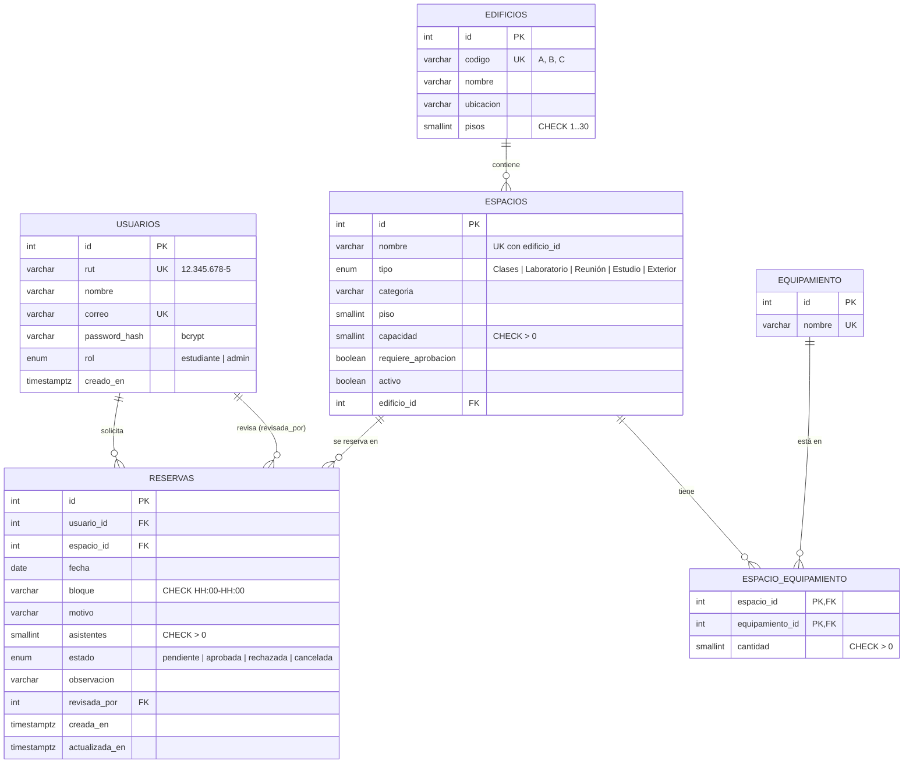
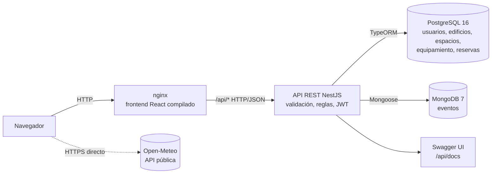
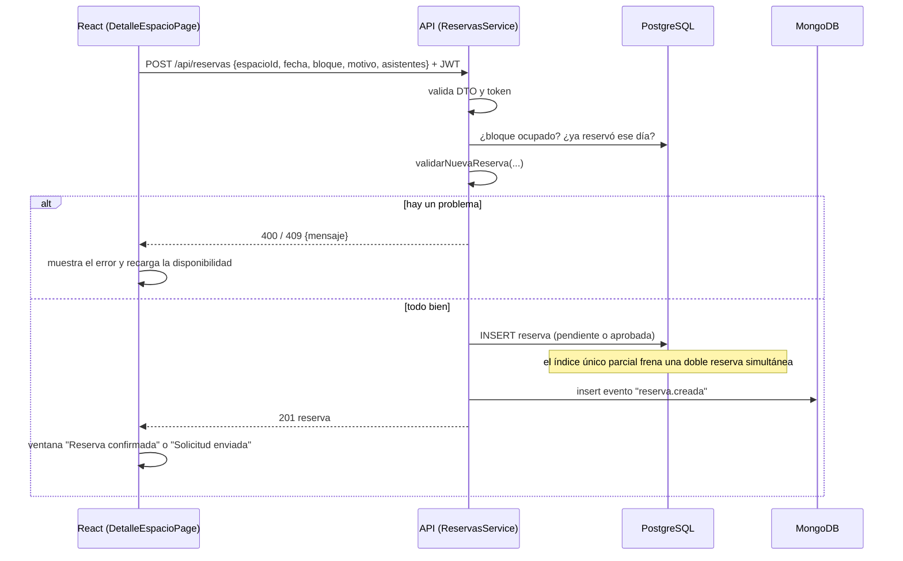

# Diseño del Hito 3: ReservaUNAB Full Stack

Este documento cubre la **Etapa 1 (diagnóstico y diseño)** del Hito 3: qué se conserva del Taller 2, cómo se amplía
el dominio, el modelo de datos SQL y NoSQL, la arquitectura y el diseño de la API.

Caso del enunciado: **3.1 Gestión de espacios universitarios.**

---

## 1. Diagnóstico del Taller 2

| | Taller 2 (prototipo frontend) | Problema |
|---|---|---|
| Espacios | 24 espacios en `src/data/espacios.json` | No se pueden crear ni editar; el edificio era solo una letra y el equipamiento, una lista de textos |
| Reservas | `localStorage` del navegador + 8 reservas "de ejemplo" | Cada navegador tenía sus propias reservas: dos personas podían reservar el mismo bloque |
| Usuarios | Perfil con RUT validado, sin contraseña | Cualquiera podía "ser" otro estudiante escribiendo su RUT |
| Reglas | `reglasReserva.js` en el navegador | Se podían saltar desde las herramientas del navegador |
| Aprobación | No existía | Laboratorios y espacios para eventos necesitan revisión |
| Historial | Solo reservas vigentes; al cancelar se borraban | No quedaba registro de lo que pasó |
| Indicadores | No existían | La sede no sabía qué espacios se usan |
| API pública | Open-Meteo con estados de carga, error y reintento | Funcionaba bien |

### Qué se reutiliza
- **Componentes y estilos**: `Navbar`, `Footer`, `EspacioCard`, `SelectorHorario`, `PanelClima`, `Ventana`,
  `Alerta`, `CampoTexto`, `MensajeVacio`, `Paginacion`, `Filtros`, los colores de `variables.css` y las imágenes.
- **Reglas de negocio**: bloques de 1 hora (08:00 a 21:00), "una reserva por día", "horario ocupado" y
  "horario que ya pasó". Se movieron al backend (`backend/src/reservas/reglas-reserva.ts`) y se ampliaron.
- **Validación del RUT** (módulo 11): ahora se aplica en el frontend y en la API.
- **Datos**: los 24 espacios y las 4 personas de las reservas de ejemplo pasan a ser los datos de prueba de la base.
- **Integración con Open-Meteo**: `useClima` y `climaApi.js` se mantienen sin cambios.
- **Patrón de `useClima`** (estados + `AbortController`): se generalizó en el hook `useApi` para consumir la API propia.

### Qué se elimina
`espacios.json`, `reservasEjemplo.json`, `datosEjemplo.js`, `useLocalStorage`, `useReservas` y `usePerfil`:
los datos operacionales ahora vienen de la API. En el navegador solo queda el token de sesión.

---

## 2. Alcance ampliado

### Actores
| Actor | Qué hace | Nuevo en Hito 3 |
|---|---|---|
| Visitante | Ve el catálogo y la disponibilidad | |
| Estudiante | Se registra, reserva, cancela, revisa sus reservas e historial | Cuenta con contraseña, historial, solicitudes |
| Administración de la sede | Gestiona edificios, espacios y equipamiento; aprueba o rechaza solicitudes; ve indicadores y actividad | Sí (actor nuevo) |

### Procesos
1. **Reserva directa**: salas de clases, de estudio y de reunión. La reserva queda *aprobada* al crearla.
2. **Solicitud con aprobación**: laboratorios y espacios exteriores (equipos delicados o eventos). La reserva queda
   *pendiente* hasta que la administración la aprueba o la rechaza con un motivo.
3. **Cancelación**: el estudiante (o la administración) cancela una reserva pendiente o aprobada que no ha empezado.
   El bloque queda libre.
4. **Gestión del catálogo**: crear, editar, desactivar y eliminar edificios, espacios y equipamiento.
5. **Seguimiento**: historial de cada reserva, bitácora de actividad e indicadores de utilización.

### Reglas de negocio
| Regla | Dónde se aplica |
|---|---|
| Un bloque de un espacio tiene a lo más una reserva activa (pendiente o aprobada) | Servicio + **índice único parcial** en PostgreSQL (`uq_reservas_espacio_fecha_bloque_activa`) |
| Un estudiante tiene a lo más una reserva activa por día | Servicio + índice único parcial (`uq_reservas_usuario_fecha_activa`) |
| Se reserva desde hoy hasta 7 días después; no en bloques que ya empezaron | `validarNuevaReserva` |
| Los asistentes no superan la capacidad del espacio | `validarNuevaReserva` + `CHECK` de asistentes > 0 |
| Los espacios inactivos no aceptan reservas ni aparecen en el catálogo | `validarNuevaReserva` + filtros |
| Solo se aprueban o rechazan solicitudes pendientes que no han empezado; rechazar exige motivo | `validarRevision` + DTO |
| Solo cancela el dueño o la administración | `validarCancelacion` |
| No se desactiva un espacio con reservas próximas; no se elimina si tiene historial | `EspaciosService` |
| No se elimina un edificio con espacios ni un equipo asignado | Servicios + claves foráneas `RESTRICT` |
| El piso de un espacio existe en su edificio | `EspaciosService` |

### Historias de usuario (priorizadas)
| # | Prioridad | Historia | Criterio de aceptación |
|---|---|---|---|
| HU1 | Alta | Como estudiante quiero reservar un bloque libre para estudiar | La reserva se guarda en PostgreSQL y el bloque aparece ocupado para todos |
| HU2 | Alta | Como estudiante quiero que el sistema me impida reservar un bloque ocupado o dos veces el mismo día | La API responde 409 con un mensaje claro y la interfaz lo muestra |
| HU3 | Alta | Como administración quiero aprobar o rechazar solicitudes de laboratorios | La solicitud cambia de estado, guarda quién la revisó y el estudiante lo ve |
| HU4 | Alta | Como estudiante quiero cancelar una reserva y liberar el bloque | Estado "cancelada"; el bloque vuelve a estar libre |
| HU5 | Alta | Como administración quiero crear y editar espacios con su capacidad, ubicación y equipamiento | CRUD completo con validaciones |
| HU6 | Media | Como estudiante quiero ver mi historial y la línea de tiempo de cada reserva | Pestaña Historial + ventana con los eventos de MongoDB |
| HU7 | Media | Como administración quiero ver la ocupación por espacio, tipo, edificio y horario | Panel con indicadores por período |
| HU8 | Media | Como administración quiero una bitácora de quién hizo qué | Página de actividad con filtros |
| HU9 | Media | Como estudiante quiero crear mi cuenta con mi RUT y correo | Registro con validaciones y contraseña cifrada (bcrypt) |
| HU10 | Baja | Como estudiante quiero ver el clima del bloque antes de reservar un espacio exterior | Se mantiene del Taller 2 |

---

## 3. Modelo de datos SQL (PostgreSQL)



Restricciones destacadas:
- **Índices únicos parciales** `WHERE estado IN ('pendiente','aprobada')`: impiden la doble reserva y la segunda
  reserva del día aunque lleguen dos peticiones al mismo tiempo. Las canceladas y rechazadas no cuentan, así el
  historial se conserva sin bloquear el horario.
- **Claves foráneas**: `RESTRICT` para no borrar edificios con espacios ni espacios con reservas;
  `CASCADE` en `espacio_equipamiento` (si se borra un espacio, se borra su lista de equipos);
  `SET NULL` en `revisada_por`.
- **Tipos enum** de PostgreSQL para rol, tipo de espacio y estado de la reserva.

El esquema se crea con la migración `backend/src/database/migrations/1762900000000-Inicial.ts` y los datos de
prueba con `backend/src/database/seed.ts` (32 usuarios, 3 edificios, 24 espacios, 25 equipos y unas 540 reservas
de las últimas 4 semanas y los próximos días).

---

## 4. Modelo documental (MongoDB)

### Colección `eventos`
Un documento por cada acción relevante del sistema. Es de **solo inserción** (nunca se edita ni se borra).

```json
{
  "_id": "6af50a302778e1cc4c999a8b",
  "tipo": "reserva.rechazada",
  "entidad": { "tipo": "reserva", "id": 517 },
  "actor": { "id": 1, "nombre": "Administración Sede Viña", "rol": "admin" },
  "datos": {
    "estadoAnterior": "pendiente",
    "estado": "rechazada",
    "observacion": "El laboratorio estará en mantención ese día."
  },
  "fecha": "2026-11-12T00:36:41.000Z"
}
```

`datos` cambia según el tipo:

| Tipo | Contenido de `datos` |
|---|---|
| `reserva.creada` | estado inicial, espacio (id, nombre, edificio), fecha, bloque, motivo, asistentes, si requería aprobación |
| `reserva.aprobada` / `rechazada` / `cancelada` | estado anterior y nuevo, observación, si canceló la administración |
| `espacio.actualizado`, `edificio.actualizado`, `equipamiento.actualizado` | `cambios: { campo: { antes, despues } }` |
| `espacio.creado` / `eliminado`, `edificio.*` | fotografía completa del registro |
| `usuario.registrado`, `usuario.sesion_iniciada` | vacío |

Índices: `{ entidad.tipo, entidad.id, fecha }` para el historial de una entidad, `{ fecha: -1 }` para la actividad
reciente y `{ tipo }` para filtrar.

### Dónde se usa
| Funcionalidad | Operación | Endpoint |
|---|---|---|
| Historial de una reserva (estudiante y administración) | `find` por entidad, ordenado por fecha | `GET /api/reservas/:id/historial` |
| Bitácora de actividad (administración) | `find` con filtros + paginación | `GET /api/actividad` |
| Movimiento diario del panel de indicadores | `aggregate` con `$group` por día y tipo | `GET /api/indicadores` |
| Registro de cada acción | `insertOne` desde los servicios | todas las operaciones de escritura |

### Por qué MongoDB y no otra tabla SQL
1. **Forma variable**: cada tipo de evento guarda datos distintos (un cambio de capacidad no se parece a un
   rechazo). En SQL serían muchas columnas vacías o un `JSON` sin estructura dentro de una tabla relacional.
2. **Fotografía del momento**: el evento guarda el nombre del espacio y de la persona *tal como eran*. Si mañana se
   renombra el espacio o se elimina, el historial sigue diciendo lo que pasó. En SQL, un `JOIN` mostraría el dato
   nuevo o fallaría.
3. **Solo inserción y alto volumen**: la bitácora crece mucho más rápido que las reservas y no necesita
   transacciones ni relaciones; un documento por evento es lo más simple.
4. **No es duplicación**: PostgreSQL guarda el **estado actual** (la reserva está "cancelada"). MongoDB guarda
   **cómo se llegó a ese estado** (quién la creó, cuándo la aprobaron, quién la canceló y por qué). Ninguna de las
   dos se puede reconstruir a partir de la otra.

**Decisión de consistencia**: PostgreSQL es la fuente de verdad. La operación se confirma primero en SQL y después
se escribe el evento. Si MongoDB no responde, la reserva igual queda hecha y el problema se registra en el log del
servidor (`ActividadService.registrar`).

---

## 5. Arquitectura



Capas del backend (por módulo):

```
controlador  →  recibe HTTP, valida el DTO, revisa el rol (@Roles) y llama al servicio
servicio     →  aplica las reglas de negocio y coordina PostgreSQL y MongoDB
reglas       →  funciones puras (reglas-reserva.ts), probadas por separado
entidad/esquema → forma de los datos en PostgreSQL (TypeORM) y MongoDB (Mongoose)
```

Elementos transversales: `GuardiaAutenticacion` (JWT y roles, global), `tuberiaValidacion` (class-validator,
rechaza campos no declarados) y `FiltroErrores` (respuestas de error uniformes sin detalles internos; convierte las
violaciones de restricciones de PostgreSQL en 409/400).

### Flujo: crear una reserva


---

## 6. Diseño de endpoints

Todas las rutas empiezan con `/api`. 🔓 = pública, 👤 = requiere sesión, 🛡️ = solo administración.

| Método | Ruta | Acceso | Propósito | Entrada | Salida |
|---|---|---|---|---|---|
| POST | `/auth/registro` | 🔓 | Crear cuenta de estudiante | `rut, nombre, correo, password` | `{ token, usuario }` 201 |
| POST | `/auth/login` | 🔓 | Iniciar sesión | `correo, password` | `{ token, usuario }` 200 / 401 |
| GET | `/auth/yo` | 👤 | Datos de la sesión | | usuario |
| PATCH | `/auth/yo` | 👤 | Editar nombre o correo | `nombre?, correo?` | usuario |
| GET | `/edificios` | 🔓 | Listar edificios con cantidad de espacios | | lista |
| GET | `/edificios/:id` | 🔓 | Detalle | | edificio / 404 |
| POST | `/edificios` | 🛡️ | Crear | `codigo, nombre, ubicacion?, pisos` | 201 / 409 |
| PATCH | `/edificios/:id` | 🛡️ | Editar | campos parciales | edificio |
| DELETE | `/edificios/:id` | 🛡️ | Eliminar (sin espacios) | | 204 / 409 |
| GET | `/equipamiento` | 🔓 | Catálogo con uso | | lista |
| POST / PATCH / DELETE | `/equipamiento[/:id]` | 🛡️ | Gestionar catálogo | `nombre` | 201 / 200 / 204 / 409 |
| GET | `/espacios` | 🔓 | Catálogo con filtros | `q, tipo, edificioId, capacidadMin, fecha, incluirInactivos` | lista (+ `bloquesLibres` si hay `fecha`) |
| GET | `/espacios/:id` | 🔓 | Detalle con equipamiento | | espacio / 404 |
| GET | `/espacios/:id/disponibilidad` | 🔓 | Estado de los 13 bloques de un día | `fecha` | `{ bloques: [{ bloque, estado }] }` |
| POST | `/espacios` | 🛡️ | Crear con equipamiento | `nombre, tipo, edificioId, piso, capacidad, requiereAprobacion?, activo?, equipamiento?[]` | 201 |
| PATCH | `/espacios/:id` | 🛡️ | Editar / activar / desactivar | campos parciales | espacio / 409 |
| DELETE | `/espacios/:id` | 🛡️ | Eliminar (sin historial) | | 204 / 409 |
| POST | `/reservas` | 👤 | Reservar o solicitar | `espacioId, fecha, bloque, motivo, asistentes` | 201 / 400 / 409 |
| GET | `/reservas/mias` | 👤 | Reservas propias | `vista=activas\|historial` | lista |
| GET | `/reservas` | 🛡️ | Todas, con filtros | `estado, desde, hasta, espacioId, edificioId, q, pagina, limite` | `{ items, total, pagina, totalPaginas }` |
| GET | `/reservas/:id` | 👤 | Detalle (propia o admin) | | reserva / 403 / 404 |
| GET | `/reservas/:id/historial` | 👤 | Eventos de MongoDB | | lista de eventos |
| PATCH | `/reservas/:id/aprobar` | 🛡️ | Aprobar solicitud | | reserva / 409 |
| PATCH | `/reservas/:id/rechazar` | 🛡️ | Rechazar con motivo | `observacion` | reserva / 400 / 409 |
| PATCH | `/reservas/:id/cancelar` | 👤 | Cancelar (dueño o admin) | `observacion?` | reserva / 403 / 409 |
| GET | `/indicadores` | 🛡️ | Utilización del período | `desde?, hasta?` | totales, por espacio, tipo, edificio, bloque y movimiento diario |
| GET | `/actividad` | 🛡️ | Bitácora (MongoDB) | `tipo, entidad, actorId, desde, hasta, pagina, limite` | `{ items, total, ... }` |
| GET | `/salud` | 🔓 | Estado de la API y las bases | | `{ api, postgres, mongo }` / 503 |
| GET | `/configuracion` | 🔓 | Bloques y días de anticipación | | objeto |

### Formato de los errores
```json
{
  "statusCode": 400,
  "error": "Solicitud inválida",
  "mensaje": "Revisa los datos enviados.",
  "detalles": { "rut": ["RUT inválido: revisa el dígito verificador (ejemplo: 12.345.678-5)."] }
}
```
`detalles` solo aparece cuando falla la validación de un formulario; el frontend lo usa para marcar cada campo.

| Código | Cuándo |
|---|---|
| 400 | Datos inválidos o una regla de negocio no se cumple (capacidad, fecha fuera de rango) |
| 401 | Sin token, token vencido o credenciales incorrectas |
| 403 | Rol insuficiente o la reserva es de otra persona |
| 404 | El recurso no existe |
| 409 | Conflicto: horario ocupado, segunda reserva del día, solicitud ya revisada, registro duplicado o en uso |
| 503 | Alguna base de datos no responde (`/salud`) |

---

## 7. Mapa de navegación actualizado

```
                      ┌────────────── Navbar (cambia según la sesión y el rol) ──────────────┐
                      │                   │                    │                │           │
               Espacios (/)     Mis reservas (/mis-reservas)  Administración   Mi perfil   Ingresar (/ingresar)
                      │          ├ Próximas                    (/admin) 🛡️     (/perfil)        │
                Ver detalle      └ Historial                    ├ Indicadores                  Crear cuenta
                      ▼               │ ventana Historial        ├ Solicitudes y reservas      (/registro)
   Detalle (/espacios/:id?fecha=)     │ (MongoDB)                ├ Espacios
   ├ elegir día (hoy + 7)             │                          ├ Edificios y equipamiento
   ├ elegir bloque (+ clima)          │                          └ Actividad (MongoDB)
   └ motivo + asistentes → confirmar ─┘
     (sin sesión → Ingresar y vuelve al detalle)

   Rutas protegidas: sin sesión → /ingresar (y vuelve); estudiante en /admin → "Solo para administradores".
```
